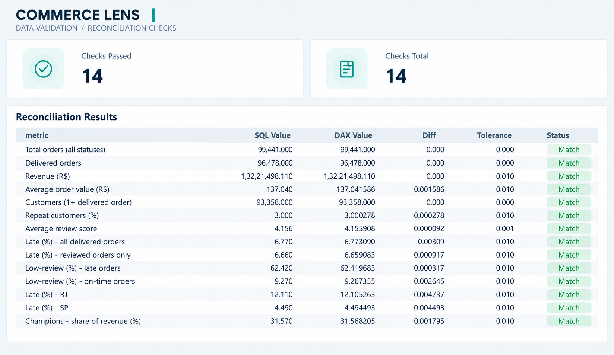
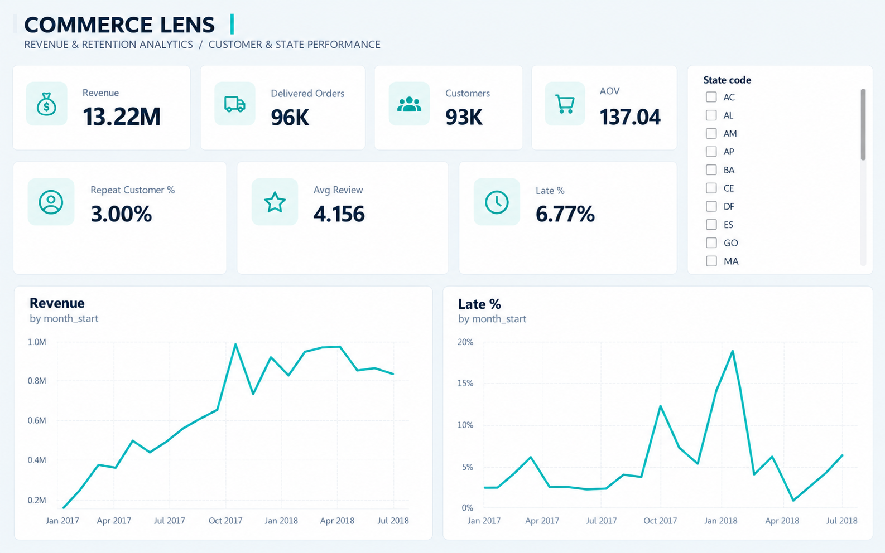
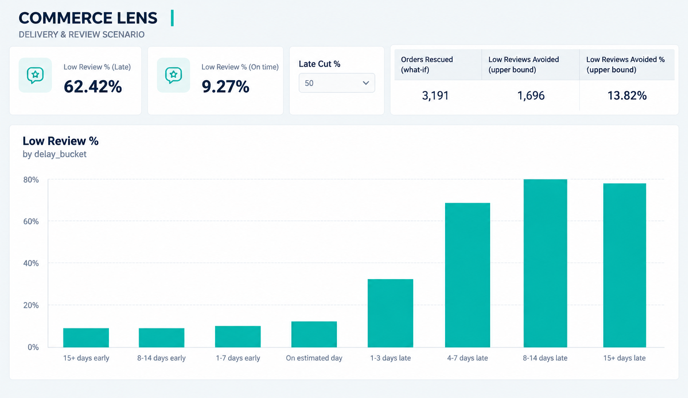
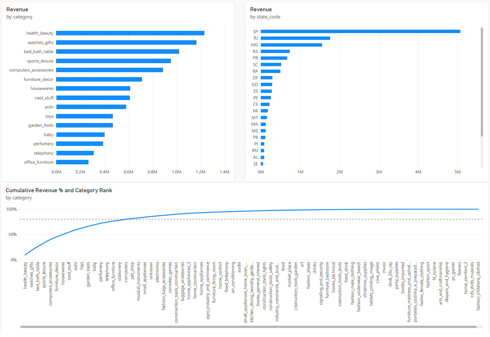
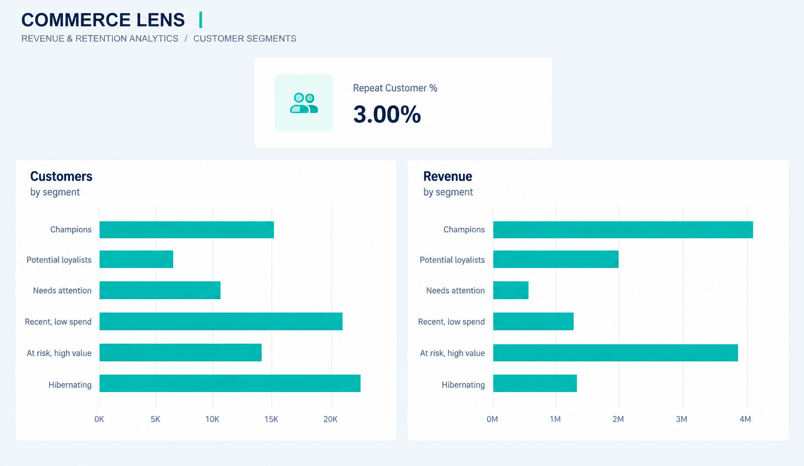

# CommerceLens — E-Commerce Revenue & Retention Analytics

**Live dashboard:** [commercelens.streamlit.app](https://commercelens-ark.streamlit.app/?page=overview)

> **Problem:** A Brazilian marketplace (Olist, ~100k orders) needs to know where its revenue comes from and what drives customer satisfaction and repeat purchases.
> **Key finding:** Late delivery is the dominant driver of bad reviews. Late orders are 6.7% of orders but get 1-2★ reviews 62.4% of the time (vs 9.3% on time), and lateness is concentrated in specific regions such as RJ, not in specific sellers. Freight price barely matters once delivery is on time.
> **Recommendation:** Treat on-time delivery as the #1 satisfaction KPI. Fix the worst delivery lanes first (SP→RJ, North-East), score order risk at purchase to intervene early, and pursue retention through CRM, because fixing delivery alone will not create repeat buyers.

**Anchor question:** *Where is revenue concentrated, and which operational factors (delivery time, freight cost, product category, region) drive customer satisfaction and repeat purchases?*

The project answers this question in three layers, each going one level deeper. A Data Analyst or Consultant reader can stop after Layer 2.

| Layer | Role lens | Output |
|---|---|---|
| 1. SQL analytics | Data Analyst | DuckDB SQL over the raw CSVs: funnel, Pareto concentration, monthly trend, RFM |
| 2. Insight → Action | Consultant | Drivers of satisfaction and retention, plus Findings & Recommendations |
| 3. Model | Data Scientist | Leakage-safe LightGBM risk score for low reviews, explained with SHAP |

---

## Results

Every number below is printed by the code in this repo (source listed per row). No figure is typed by hand anywhere in the notebooks or the dashboard.

| Metric | Value | Source |
|---|---|---|
| Delivered orders / all orders | 96,478 / 99,441 | `sql/10_kpis.sql` |
| Revenue (item price, delivered) | R$13,221,498 | `sql/10_kpis.sql` |
| Average order value | R$137.04 | `sql/10_kpis.sql` |
| Unique customers (`customer_unique_id`) | 93,358 | `sql/10_kpis.sql` |
| Orders reaching the customer | 97.0% | `sql/02_order_funnel.sql` |
| Categories producing 80% of revenue | 18 of 74 (top 10 = 62.4%) | `sql/03_pareto_category.sql` |
| Revenue share of top 20% of sellers | 82.3% | `sql/04_pareto_seller.sql` |
| Revenue share of SP + RJ + MG | 63.4% (SP alone 38.3%) | `sql/05_revenue_by_state.sql` |
| Jan–Aug revenue growth, 2018 vs 2017 | +141.1% | `sql/06_monthly_trend.sql` |
| Customers who bought exactly once | 97.0% (repeat rate 3.00%) | `sql/07_order_frequency.sql` |
| RFM "Champions": share of customers / revenue | 16.5% / 31.6% | `sql/09_rfm_segments.sql` |
| 1-2★ rate: late vs on-time orders | 62.4% vs 9.3% (6.7x) | `sql/12_late_vs_ontime.sql` |
| Share of all 1-2★ reviews coming from late orders | 32.4% | `02_insights.ipynb` |
| Late rate: RJ vs SP | 12.1% vs 4.5% | `sql/14_state_ops.sql` |
| State late % vs low-review %, weighted correlation | r = 0.95 | `02_insights.ipynb` |
| 1-2★ rate (on-time orders), freight <10% → 50%+ of price | 8.75% → 9.80% | `sql/15_freight_ratio_vs_review.sql` |
| 180-day repeat rate: late vs on-time first order | 2.65% vs 3.14% (p = 0.093) | `sql/16_first_order_vs_repeat.sql` |
| Low-review model ROC-AUC / PR-AUC (stratified test) | 0.673 / 0.269 (no-skill: 0.500 / 0.128) | `03_model.ipynb` |
| Low-review model ROC-AUC / PR-AUC (out-of-time test) | 0.611 / 0.181 (base rate 0.100) | `03_model.ipynb` |
| Low reviews caught by flagging the riskiest 10% of orders | 25.6% (32.8% precision) | `03_model.ipynb` |

To regenerate everything, see [Setup & run](#setup--run).

---

## Layer 1 — SQL analytics (`notebooks/01_sql_analytics.ipynb`)

DuckDB runs real SQL directly against the 9 raw CSVs, with no database to set up. Every query is a file in [`sql/`](sql) that the notebook loads, so the SQL is readable on its own.

- **Base views** (`00_base_views.sql`): joins across orders, items, products, sellers, customers and reviews. `ROW_NUMBER()` keeps the latest review per order.
- **Why `customer_unique_id`:** Olist issues a new `customer_id` for every order, so counting customers by `customer_id` treats every repeat buyer as a new customer. All customer-level work uses `customer_unique_id`.
- **Funnel** is built from lifecycle timestamps (approved → handed to carrier → delivered), not just final status.
- **Pareto** by category, seller and state uses running window sums (`SUM() OVER (ORDER BY … ROWS UNBOUNDED PRECEDING)`).
- **Monthly trend** uses `LAG()` for month-over-month growth. Sparse edge months (under 500 orders) are flagged and excluded.
- **RFM** uses `NTILE(5)` on Recency and Monetary. **Frequency is not scored:** 97.0% of customers buy once, so frequency quintiles would be meaningless. It is kept as a repeat-buyer flag.

**Takeaway:** revenue is concentrated in a few categories, the top 20% of sellers, and the South-East (SP/RJ/MG). The customer base is almost entirely one-time buyers.

## Layer 2 — Insight → Action (`notebooks/02_insights.ipynb`)

The notebook quantifies delivery delay vs review score, freight burden by category and region, and the effect of the first order on repeat purchase. Significance is tested with a two-proportion z-test and a chi-square test.

### Findings & Recommendations

| # | Problem | Finding | So what | Recommended action |
|---|---|---|---|---|
| 1 | Which operational factor hurts satisfaction most? | Late orders are 6.7% of orders but get 1-2★ reviews 62.4% of the time vs 9.3% on time (6.7x). They generate 32.4% of all low reviews, and even 1–3 days late gives 32.1%. | Lateness is the biggest lever on ratings. Up to ~3,392 low reviews (27.6% of all) are attributable to it (upper bound). | Make on-time delivery the #1 satisfaction KPI. Flag at-risk orders at purchase (Layer 3), notify customers proactively, and put carrier SLAs on the late tail. |
| 2 | Is lateness regional? | RJ (13.3% of revenue) is late 12.1% of the time vs 4.5% in SP, with 18.3% vs 10.7% low reviews. CE, MA, PI, AL and SE run at 2x+ the national late rate (6.8%). State late rate vs low-review rate: r = 0.95. | Lateness sits in specific delivery routes. RJ is where the most revenue is at stake. | Audit carriers and delivery-date logic on the SP→RJ and North-East routes first. Widen the promised date where a route can't be fixed. |
| 3 | Which categories pair revenue with poor experience? | office_furniture: 21.9% low reviews vs 12.8% overall and 20.6 avg delivery days. bed_bath_table (16.0%) and computers_accessories (14.6%) are top-5 revenue categories above average. | Bulky and slow categories carry a hidden satisfaction penalty. | Set category-specific delivery promises and packaging standards, and review these categories monthly. |
| 4 | Does freight cost drive dissatisfaction? | On on-time orders, the low-review rate moves only 8.75% → 9.80% from the lowest to the highest freight share (1.05 pt), against a 53.2 pt gap for lateness. | Freight price is a weak satisfaction driver. | Fund delivery reliability, not freight subsidies. Test free-shipping thresholds as a *conversion* lever instead. |
| 5 | Is seller concentration an operational risk? | The top 20% of sellers (82.3% of revenue) are late 6.79% of the time vs 6.59% for the rest. | Lateness is not a small-seller problem, so pruning the long tail won't fix it. | Fix delivery routes rather than sellers, and support key sellers with account management and on-time scorecards. |
| 6 | Why don't customers come back? | The 180-day repeat rate is 3.10%. A late first order gives 2.65% vs 3.14% (p = 0.093, not significant), and first review score shows no link (p = 0.775). | Retention is structurally low. Better delivery protects ratings but will not create loyalty on its own. | Build lifecycle CRM (cross-sell, reactivation), starting with "At risk, high value" customers (15.6% of customers, 30.6% of revenue). |

## Layer 3 — Model (`notebooks/03_model.ipynb`)

**Target choice.** Both candidates were built and scored with the same pipeline, and the choice is made in code:

| Target | Positive rate | ROC-AUC | PR-AUC (lift over base rate) | Precision in top 10% |
|---|---|---|---|---|
| Repeat purchase within 180 days | 3.1% | 0.612 | 0.048 (1.54x) | 5.2% |
| **Low review (1-2★)** ✅ | 12.8% | 0.673 | 0.269 (2.10x) | 32.8% |

Repeat purchase is too rare and too weakly predictable to act on, which fits Layer 2's finding that first-order experience barely moves it. Low review has usable signal and is directly actionable.

**Setup**
- **Prediction time is order placement.** Features (`sql/18_order_features.sql`) are only what is known then: order value, freight, promised delivery window, product size, payment, customer and seller state, seller-to-customer distance, and *prior* order counts.
- **Excluded to avoid leakage:** actual delivery and carrier dates, delay, approval time, and anything from the review.
- **Training:** LightGBM with early stopping on an inner validation split, a stratified 80/20 train/test split, a logistic-regression baseline, and a no-skill baseline.

**Results**
- LightGBM reaches ROC-AUC 0.673 and PR-AUC 0.269 on the test set, against 0.629 / 0.232 for logistic regression.
- Flagging the riskiest 10% of orders catches 25.6% of low reviews.
- **Honest check:** trained on orders before May 2018 and tested on later ones, the model drops to ROC-AUC 0.611 and PR-AUC 0.181 (1.81x the base rate). The random split is optimistic because `purchase_month` partly encodes period-specific logistics shocks (Nov 2017, Feb–Mar 2018).

**SHAP**
- The top drivers are `purchase_month`, `customer_state`, `n_items`, `main_category` and `seller_state`.
- The highest-risk states (RJ, BA, PA) line up with Layer 2's late-delivery states.
- Multi-item orders sharply raise risk, longer seller-to-customer distance raises it, and longer promised windows lower it.

---

## Dashboard

`dashboard/app.py` is a Streamlit app with a Material 3-style interface: sidebar navigation, elevated cards, and KPI cards with sparklines. It has six pages (Overview, Revenue, Customers & RFM, Satisfaction drivers, Risk model, Findings), and each page has its own link (`?page=model`).

It covers KPI cards, the order funnel, revenue Pareto, monthly trend, RFM segments, delivery delay vs review score, and the model's SHAP summary. The interactive parts are:
- **What-if simulator:** reduce late deliveries by X% and see the projected change in 1-2★ reviews and average rating. This is an upper-bound scenario built on the Layer 2 rates.
- **Triage simulator:** flag the riskiest X% of orders at purchase and see how many low reviews the model catches per month.
- **Click-to-inspect profiles** for categories and states, plus a state spotlight that applies across every page.
- **Pareto switcher** (category / seller / state) with a top-N slider, and a zoomable monthly trend.
- **RFM treemap** with a segment explorer, and ROC/PR curves with a SHAP beeswarm where you choose the features.

Deployment notes:
- It reads **only** the small pre-aggregated parquet files in `dashboard/data/` (about 0.4 MB, built by `scripts/build_dashboard_data.py` from the same SQL and model code).
- Because of that, it deploys to Streamlit Community Cloud without the raw data.
- The theme lives in `.streamlit/config.toml`.
- A Power BI version of the analysis is described in the Power BI layer section below; build notes are in [`docs/powerbi_notes.md`](docs/powerbi_notes.md).

## Power BI layer

A Power BI semantic model on the same SQL definitions as the notebooks and the dashboard, with every DAX measure reconciled against SQL.

- **Export:** `scripts/build_powerbi_data.py` builds a star schema (`fact_orders`, `fact_order_items`, five dimensions) from the DuckDB views, with the SQL scope rules as 0/1 flags so no measure compares against BLANK. Integrity checks run on every export: unique keys, no orphan foreign keys, revenue ties out to `sql/10`.
- **Measures:** [`powerbi/dax_measures.md`](powerbi/dax_measures.md) holds KPIs, category Pareto, month-over-month growth, delay buckets, lateness by customer and seller state, the freight test, the late-delivery what-if (upper bound), RFM and the model page. Each names the SQL file it mirrors.
- **Reconciliation:** `scripts/verify_powerbi_measures.py` re-implements each measure in pandas with the model's filter context and relationships, then compares it with SQL (all 905 measure checks match). A Reconciliation page in the report shows the 14 headline measures next to their SQL values.
- **Model as code:** `scripts/build_powerbi_tmdl.py` generates the TMDL semantic model in `powerbi/CommerceLens.SemanticModel/`.
- **Power BI report:** `powerbi/CommerceLens.pbip` (open in Power BI Desktop and set the DataFolder parameter first, see [`powerbi/README.md`](powerbi/README.md)). Five pages: Reconciliation (14/14 DAX vs SQL), Overview, Satisfaction drivers (late vs on-time reviews by delay bucket, what-if simulator), Revenue (top-15 categories, revenue by state, Pareto) and Customers & RFM. PDF export: [`docs/powerbi/CommerceLens.pdf`](docs/powerbi/CommerceLens.pdf). In the PDF the state slicer and the revenue-by-state chart are cut off (a PDF cannot scroll); the live report shows all states.

Status: the export and SQL comparisons are verified. In Power BI Desktop the project opens, all tables load, and the 14 reconciliation measures reproduce the SQL values (14/14 Match). The what-if simulator (50% and 100% cuts), the category Pareto (rank 17 = 79.69% cumulative, matching SQL), the revenue-by-category and by-state rankings and the late/low-review-by-delay-bucket chart were also checked against SQL in Desktop. Other measures (month-on-month growth, seller-state, freight, seller tiers, model-page and colour measures) are logic-checked in pandas but have not been run in Desktop. The report has five pages (Reconciliation, Overview, Satisfaction drivers, Revenue, Customers & RFM); a PDF export is in [`docs/powerbi/CommerceLens.pdf`](docs/powerbi/CommerceLens.pdf). Risk model, Findings and lead-time pages are not built. The reconciliation tests the DAX layer against SQL (measure logic, relationships, filter propagation); it does not re-derive SQL inputs such as delay_days. Details: [`docs/powerbi_notes.md`](docs/powerbi_notes.md) (routes, reconciliation scope, why the late rate appears as 6.66%, 6.77% and 6.8%), [`docs/powerbi_requirements_map.md`](docs/powerbi_requirements_map.md), [`docs/powerbi_data_dictionary.md`](docs/powerbi_data_dictionary.md), [`docs/powerbi_build_checklist.md`](docs/powerbi_build_checklist.md). The Power BI scripts run in a separate Python 3.13 environment ([`powerbi/README.md`](powerbi/README.md)).

### Report pages

Screenshots of the five report pages (the same pages are in [`docs/powerbi/CommerceLens.pdf`](docs/powerbi/CommerceLens.pdf)).

**Reconciliation:** every DAX measure checked against the SQL layer, 14 of 14 match.



**Overview:** headline KPIs with monthly revenue and late-delivery trends (sparse edge months excluded).



**Satisfaction drivers:** low-review rate by delivery delay, late vs on-time orders, and the late-delivery what-if simulator (an upper bound, shown at a 50% cut).



**Revenue:** top-15 categories, revenue by state and the category Pareto curve with the 80% line.



**Customers and RFM:** customers and revenue by RFM segment.


## Repository structure

```
check_data.py                  verifies the 9 CSVs are present in DATA_DIR
src/config.py                  DATA_DIR (repo root by default; env COMMERCELENS_DATA_DIR)
src/db.py                      DuckDB: CSVs as views, run sql/ files
src/features.py                purchase-time model datasets
src/model.py                   LightGBM / baseline training, metrics, SHAP
sql/                           00–22 query files (loaded by notebooks and the build scripts)
notebooks/01_sql_analytics     Layer 1
notebooks/02_insights          Layer 2
notebooks/03_model             Layer 3
scripts/build_dashboard_data.py  CSVs -> dashboard/data/*.parquet
dashboard/app.py               Streamlit app (+ slim requirements.txt for deployment)
.streamlit/config.toml         dashboard theme
scripts/build_powerbi_data.py      CSVs -> powerbi/data/*.parquet (star schema + integrity checks)
scripts/verify_powerbi_measures.py pandas mirror of every DAX measure vs SQL
scripts/build_powerbi_tmdl.py      TMDL semantic model from the parquet schemas + DAX file
powerbi/                       CommerceLens.pbip project: CommerceLens.Report/ (report pages) and
                               CommerceLens.SemanticModel/ (TMDL model); DAX measures, theme, Python 3.13 env pins
docs/powerbi/CommerceLens.pdf  PDF export of the Power BI report
docs/powerbi_notes.md          Power BI rebuild guide (routes, reconciliation scope, late-rate note)
docs/powerbi_*.md              requirements map, data dictionary, build checklist
```

## Tech stack

Python 3.11 · DuckDB (SQL) · pandas · LightGBM · scikit-learn · SHAP · SciPy · matplotlib · Plotly · Streamlit · Jupyter · Power BI (DAX, PBIP/TMDL)

## Setup & run

Windows PowerShell, from the repo root:

```powershell
# 1. Environment
py -3.11 -m venv .venv
.\.venv\Scripts\Activate.ps1
python -m pip install --upgrade pip
pip install -r requirements.txt

# 2. Data: download from Kaggle and unzip the 9 CSVs into the repo root
#    https://www.kaggle.com/datasets/olistbr/brazilian-ecommerce
python check_data.py
#    (or keep the CSVs elsewhere:  $env:COMMERCELENS_DATA_DIR = "D:\data\olist")

# 3. Notebooks (executes and saves outputs)
jupyter nbconvert --to notebook --execute --inplace notebooks/01_sql_analytics.ipynb
jupyter nbconvert --to notebook --execute --inplace notebooks/02_insights.ipynb
jupyter nbconvert --to notebook --execute --inplace notebooks/03_model.ipynb

# 4. Dashboard
python scripts/build_dashboard_data.py
streamlit run dashboard/app.py
```

If script activation is blocked, run `Set-ExecutionPolicy -Scope CurrentUser RemoteSigned` once. On Linux or macOS, activate with `source .venv/bin/activate`. The code uses `pathlib` throughout, so no paths change.

## Limitations

- **One-time-buyer skew.** 97% of customers buy once, so frequency-based segmentation and repeat-purchase modelling have little signal. RFM therefore segments on Recency × Monetary.
- **2016–2018 Brazil data.** This is a single marketplace in a specific period. Carrier networks, customer expectations and the platform have changed since, and the edge months are sparse and excluded from trend reads.
- **Correlation, not causation.** Late → low review is plausible causally (reviews are written after delivery), but routes, categories and sellers are intertwined. The "attributable low reviews" figure is an upper bound.
- **Review coverage.** Satisfaction is measured only on delivered orders that have a review.
- **No traffic or funnel data.** Freight's effect on *conversion* can't be measured, only its effect on post-purchase satisfaction.
- **The model is a triage score.** At purchase time the biggest driver (whether the delivery will actually be late) is unknown, so moderate AUC is expected. The out-of-time score is the fair estimate.

## Data & license

The data is the [Olist Brazilian E-Commerce Public Dataset](https://www.kaggle.com/datasets/olistbr/brazilian-ecommerce) by Olist, published on Kaggle under **CC BY-NC-SA 4.0**. The raw CSVs are not redistributed in this repo (they are gitignored). The committed `dashboard/data/*.parquet` files are small aggregates derived from the dataset under the same license terms.
